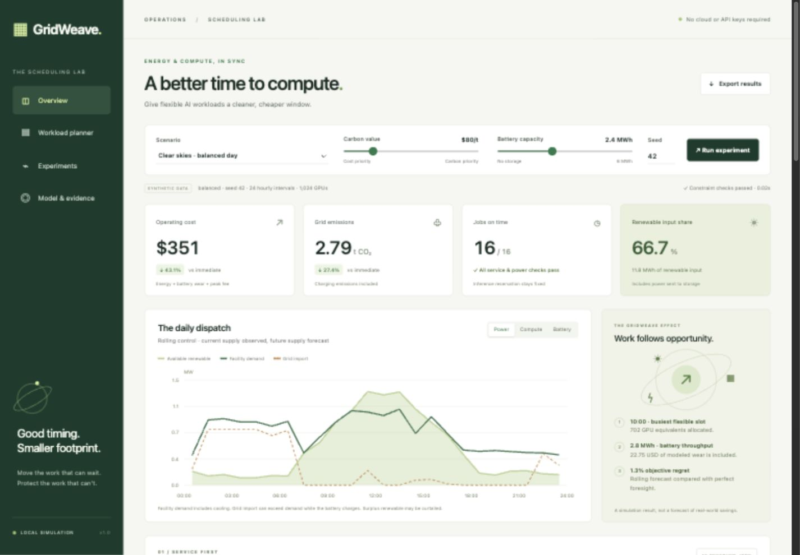

# GridWeave
### Smarter Compute. Cleaner Power.

[](https://github.com/xukelvin24665-glitch/gridweave/actions/workflows/checks.yml)

**A reproducible energy-and-compute scheduling lab for HackSHSID 2026, Track 2.** GridWeave jointly schedules flexible AI jobs, renewable consumption, grid imports, and battery storage while keeping inference reservations and job deadlines fixed.

The project includes a working dashboard, a mixed-integer optimizer, a forecast-aware rolling controller, five policy comparisons, independent physical checks, and a committed 280-run experiment suite. It is a local research prototype: it simulates a data center rather than controlling live infrastructure. All demonstration inputs are synthetic.



## Start the dashboard

Requires **Python 3.12 or newer**. No API keys, JavaScript build tools, accounts, or paid services are needed. The first installation downloads Python dependencies.

```bash
python3 -m venv .venv
source .venv/bin/activate
python -m pip install -r requirements.txt -e .
python -m gridweave serve
```

Open **http://127.0.0.1:8765**. On Windows, use `python` for environment creation and `.venv\Scripts\activate` for activation. On macOS/Linux, `sh scripts/run.sh` also installs dependencies and starts the app. If the port is in use, add `--port 8766`.

Choose a scenario, carbon value, battery capacity, and random seed. Run the experiment, inspect the hourly power/compute/storage charts and job heatmap, compare all five policies, trace the cost–carbon frontier, and export the complete inputs, schedules, metrics, and solver certificates as JSON. The saved multi-seed evidence at the bottom uses the documented default parameters; it is separate from the current controls.

## What is being optimized?

The objective is **grid electricity cost + battery wear + an illustrative peak fee + carbon value × grid emissions**. USD is a consistent modeling unit; these tariffs do not represent a real utility.

- Online inference runs in its original slot and reserves GPU capacity first.
- Training and batch inference jobs can be paused, divided into GPU equivalents, and moved only between release and deadline.
- Grid limits, total GPUs, per-job parallelism, power balance, battery losses, minimum reserve, and battery power/energy limits are hard constraints.
- A binary battery mode prevents simultaneous charge and discharge. The battery must finish with the energy it started with.
- The rolling controller observes current renewable supply and replans every hour. It uses day-ahead future forecasts, with a conservative zero-renewable assumption in the last four future slots.

Read the [full model and assumptions](docs/MODEL.md), [research references](docs/REFERENCES.md), and [judge presentation and Q&A](docs/PITCH.md).

## Evidence, not just a demo

The [committed results](results/RESULTS.md) report **20 seeds × 7 conditions**, with paired 95% confidence intervals and failure counts. The conditions are clear skies, cloudy weather, a price spike, tight deadlines, a forecast shock, grid stress, and lower battery efficiency. The JSON and CSV preserve every run and policy, including numerical feasibility checks.

A separate [holdout report](results/holdout/RESULTS.md) evaluates **20 additional seeds × 7 conditions**, using seeds 100–119 after fixing the closing-hours guard on seeds 0–19. This checks the same synthetic generator beyond the tuning seeds; it is not validation against real facilities.

On the default synthetic day (seed 42), rolling control reduces operating cost from **$616.23 to $350.84** and grid emissions from **3.835 to 2.785 tonnes CO2**, with **16/16 jobs on time**. These are 43.1% cost savings and 27.4% carbon savings on that one example. The broader reports quantify how the results change.

| Policy | Compute schedule | Storage | Forecast information |
|---|---|---|---|
| Immediate execution | Ready work now, earliest deadline first | Idle | Current observations |
| Compute shifting only | Optimized | None | Perfect foresight |
| Battery only | Fixed to immediate execution | Optimized | Perfect foresight |
| Joint oracle | Optimized | Optimized | Perfect foresight |
| GridWeave rolling | Replanned hourly | Replanned hourly | Current actual + future forecasts + closing guard |

The oracle reports the HiGHS lower bound and relative MILP gap for the explicit mathematical model. Rolling control is compared against that oracle through objective regret. A subproblem gap is **not** advertised as a global rolling-control guarantee. A feasible schedule must also pass a separately implemented validator.

```bash
# Default demonstration, including the cost–carbon frontier
python -m gridweave demo --frontier
python -m gridweave validate results/demo.json

# Reproduce all 280 experiments and refresh all evidence snapshots
python scripts/refresh_results.py

# Shorter experiment or a different carbon value
python -m gridweave benchmark --seeds 3 --scenario forecast_shock --output-dir output/check
python -m gridweave demo --scenario grid_stress --seed 6 --carbon-price 160

# Bring your own inputs: same JSON schema as the included example
python -m gridweave solve --input examples/balanced.json --output output/custom.json

# Deliberately overloaded input: reports infeasibility and exits with code 2
python -m gridweave solve --input examples/infeasible.json --output output/infeasible.json

# Mathematical, regression, physical validation, and HTTP tests
python -m unittest discover -s tests -v
```

## What the results cannot claim

Synthetic workloads and power curves demonstrate behavior, not measured industry savings. The model assumes known job reservations, known inference demand, checkpointable fluid workloads, fixed PUE, and linear marginal power. It excludes topology, placement, checkpoint overhead, thermal dynamics, outages, and capital costs. Carbon intensity is an accounting factor, not a causal marginal-emissions estimate. Changing these assumptions can change the conclusion.

The closing-hours guard reduces an observed forecast-induced battery-restoration failure. It does not prove feasibility against arbitrary forecast errors. Overloaded jobs, insufficient grid power, unexpected demand, and extreme forecast errors can still make the model infeasible. Such runs report errors and do not invent successful schedules or savings. A retained regression test demonstrates an unguarded failure on grid-stress seed 6.

## Repository guide

```text
src/gridweave/
  models.py           Validated scenario, facility, job, schedule types
  scenarios.py        Seeded paired synthetic scenarios and forecasts
  optimizer.py        Joint MILP, incumbent check, lower bound and gap
  policies.py         Immediate EDF and guarded rolling control
  validation.py       Independent service and physical constraints
  metrics.py          Costs, emissions, renewable input, service metrics
  experiment.py       Comparators, ablations, objective regret, frontier
  benchmark.py        Multi-seed evaluation, intervals, JSON/CSV report
  server.py / web/    Local HTTP API and responsive dashboard
examples/             Complete editable input scenario
results/              Reproducible outputs and human-readable results
docs/                 Model, sources, pitch, architecture, submission guide
tests/                Mathematical, physical, regression and API checks
.github/workflows/    Cross-version verification on GitHub Actions
```

The dashboard is served only on the local loopback address. Static assets have no external dependencies. The custom scenario API is documented in [ARCHITECTURE.md](docs/ARCHITECTURE.md).

## GitHub submission

Published as a public repository: **[github.com/xukelvin24665-glitch/gridweave](https://github.com/xukelvin24665-glitch/gridweave)**. The full source, committed results, and documentation are available there. This folder remains a complete local Git repository on `main`, with `origin` pointing at the published repository; a GitHub remote is not required to run it. The contest tutorial requires judge-visible access, so verify the public page while signed out. The [submission guide](docs/SUBMISSION.md) records the publication and verification steps.

**License:** MIT. Research references are credited in the documentation. Contest PDFs are not redistributed.
