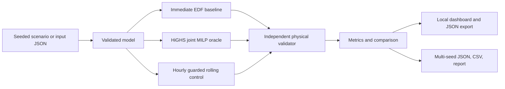

# Architecture and API



The Python package exposes a command-line interface and a standard-library local HTTP server. NumPy provides arrays and seeded random generation; SciPy provides sparse constraint assembly, HiGHS MILP solving, and Student-t quantiles. The dashboard uses browser-native HTML/CSS/JavaScript and SVG. It has no build step, external fonts, frontend framework, database, authentication service, or external API requirement.

`models.py` validates raw inputs. `optimizer.py` solves and checks an incumbent. `validation.py` independently reconstructs constraints from a complete scenario and schedule. `experiment.py` collects all policies and keeps failures visible. `benchmark.py` retains paired evidence and confidence intervals. The UI does not calculate savings independently: it displays the metrics returned by the backend.

## Local endpoints

The server binds to `127.0.0.1` and accepts only local Host names. It is a development/demo server, not an internet-facing production service.

| Method | Endpoint | Purpose |
|---|---|---|
| GET | `/api/health` | Version and readiness |
| GET | `/api/scenarios` | Scenario IDs and descriptions |
| GET | `/api/experiment?scenario=balanced&seed=42&carbon_price=80&battery=2.4` | Five policies, full schedules, metrics, bounds, errors |
| GET | `/api/frontier?scenario=balanced&seed=42&battery=2.4` | Six perfect-forecast carbon-price points |
| GET | `/evidence.json` | Committed multi-seed summary, independent of current controls |
| POST | `/api/solve` | Evaluate a custom scenario, JSON body below |

The JSON body contains a `scenario` object with the schema in `examples/balanced.json` and an optional numeric `carbon_price`. This complete example sends the included scenario:

```python
import json
from urllib.request import Request, urlopen

scenario = json.load(open("examples/balanced.json"))
body = json.dumps({"scenario": scenario, "carbon_price": 80}).encode()
request = Request("http://127.0.0.1:8765/api/solve", body,
                  {"Content-Type": "application/json"})
with urlopen(request) as response:
    result = json.load(response)
print(result["savings_vs_immediate"])
```

Custom inputs are limited to 48 slots, 80 jobs, and a 256 KiB request. Prices and carbon factors must be finite and nonnegative; negative-price markets would need additional objective/renewable-policy analysis and are deliberately rejected. Carbon value is 0–2000 USD/tonne and generated battery capacity is 0–10 MWh through HTTP controls. Scenario seeds are integers in `[0, 2^32-1]`.

A completed experiment can return HTTP 200 with per-policy `errors`: an infeasible comparator is a scientific result, not a transport error. Check each policy's `metrics.validation.valid`. Input errors use 400/413/415, unavailable endpoints use 404, and a busy solver uses 503. Solve requests are serialized to avoid competing native optimizer calls; repeated generated experiments use a bounded memory cache. The server imposes a 15-second limit per MILP subproblem, so unusually hard custom rolling scenarios can take several minutes.

Static file paths are allowlisted. JSON writes require the expected content type and same-origin requests; there are no shell commands, user file reads, uploads, secrets, or external network calls in request handling. This does not make the standard-library server a production deployment target.

## Evidence regeneration

`python scripts/refresh_results.py` writes these outputs from the same benchmark object:

- `results/benchmark.json`: all 140 runs and 700 policy evaluations.
- `results/benchmark.csv`: one row per available policy evaluation.
- `results/RESULTS.md`: paired means, intervals, and failure counts.
- `results/holdout/`: the same three output formats for 140 additional runs, seeds 100–119.
- `src/gridweave/web/evidence.json`: benchmark summary for the packaged dashboard.
- `results/demo.json`: default seed 42, complete schedules and frontier.
- `examples/balanced.json`: the corresponding complete editable input.

Versions are pinned in `requirements.txt`. Timings, branch-and-bound internals, and equally optimal schedules may differ by platform or dependency version. Compare objective values, feasibility, and solver gaps within tolerances rather than expecting byte-identical output.
